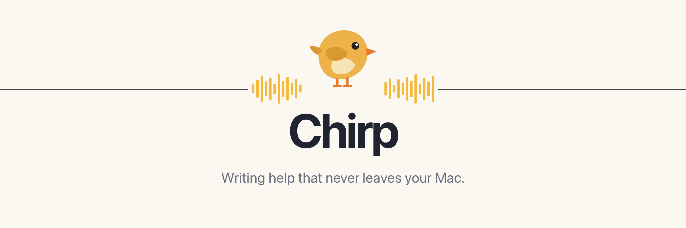
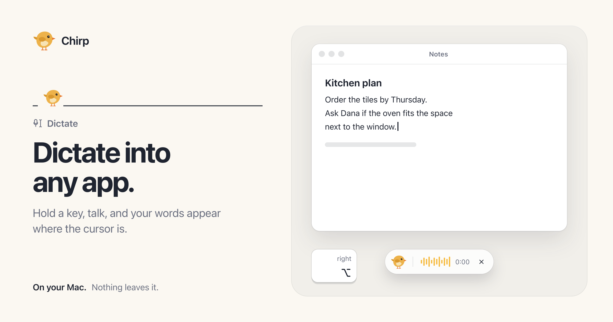
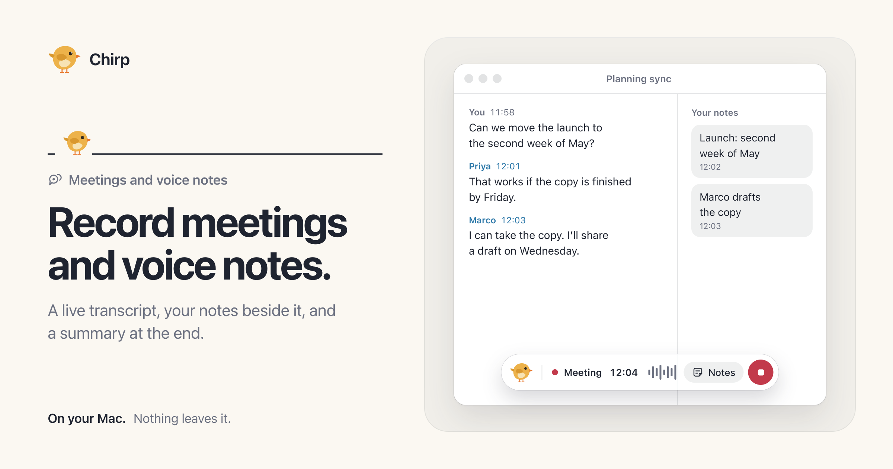
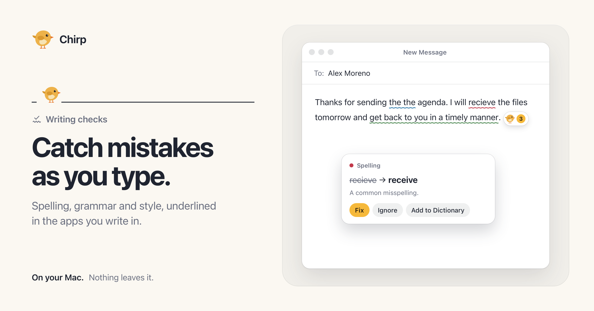
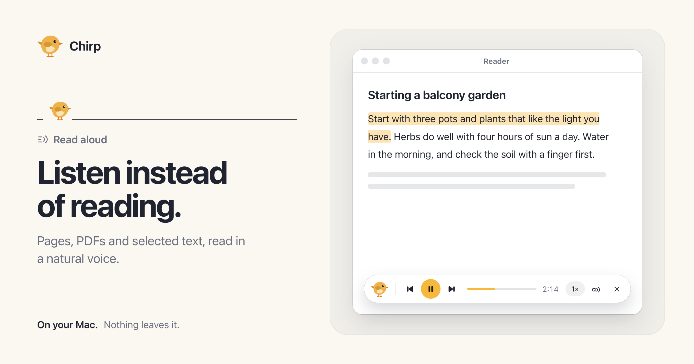
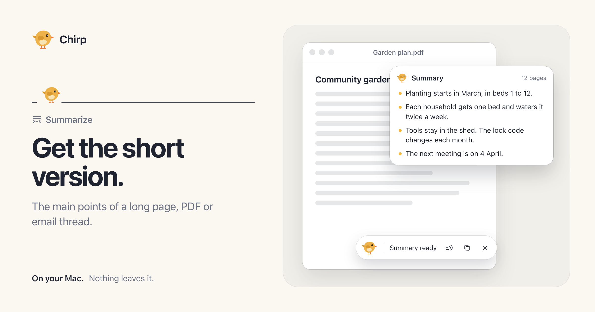
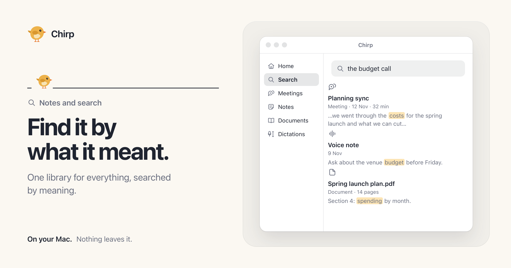

<!-- The banner and feature images are made in Site/ (see Site/README.md). -->
<p align="center">
  
</p>

<h1 align="center">Chirp</h1>

<p align="center">
  Dictate, record, check your writing, listen and summarize. On your Mac, with nothing sent anywhere.
</p>

<p align="center">
  <a href="https://github.com/jakeflavin/chirp/releases/latest/download/Chirp.dmg"><b>Download for Mac</b></a> ·
  <a href="https://jakeflavin.github.io/chirp">Website</a> ·
  <a href="https://github.com/jakeflavin/chirp/discussions">Discussions</a>
</p>

---

Chirp is a free, open-source Mac app for your own words. It lives in a small bar at the edge of the screen, the perch, and in the menu bar. Every model runs on your Mac. There's no account and no server, and nothing you say, type or record leaves the Mac.

| | |
|---|---|
| **Dictate** | Talk into any app with a shortcut. Chirp types what you say, cleans up filler words, and learns your names and words. |
| **Record** | Meetings, calls and voice notes, with a live transcript and notes afterwards. No bot joins the call. |
| **Write checks** | Spelling and grammar underlines in the apps you type in, plus Fix and Rephrase for a sentence. |
| **Read aloud** | Selected text, pages, PDFs and books, in a natural voice. |
| **Summarize** | Pages, PDFs and emails, section by section. Each point is checked against the source. |
| **Notes** | Type or say a note, and find it later by what it means, not only the exact words. |

<table>
  <tr>
    <td></td>
    <td></td>
  </tr>
  <tr>
    <td></td>
    <td></td>
  </tr>
  <tr>
    <td></td>
    <td></td>
  </tr>
</table>

## Install

1. [Download Chirp.dmg](https://github.com/jakeflavin/chirp/releases/latest/download/Chirp.dmg) and drag Chirp to Applications.
   This version isn't notarized by Apple yet, so the first time you open it macOS says it can't check Chirp. Click **Done**, open **System Settings › Privacy & Security**, scroll down to "Chirp was blocked", click **Open Anyway** and confirm. You only need to do this once.
2. Open Chirp. A short setup asks for the permissions each feature needs (microphone, accessibility, and screen and system audio for recording calls). You can skip any of them and turn them on later.
3. Chirp downloads its models the first time a feature needs them: about 730 MB for speech and 1.6 GB for the language model, plus smaller ones for the voice and search. [Docs/MODELS.md](Docs/MODELS.md) lists every model and where it comes from.

**Requirements:** a Mac with Apple Silicon (M1 or later) and macOS 26 or later. 16 GB of memory is comfortable. 8 GB works, with models taking turns.

**Updates:** Chirp checks for updates itself. To try new features early, turn on **Settings › General › Updates › Get beta versions**. Beta versions have a beta icon and are marked in the app.

## Privacy

Everything runs on your Mac. Chirp only uses the network to download its models and tools, to check for updates, and when you open a link yourself. [Docs/PRIVACY.md](Docs/PRIVACY.md) lists every network call and every permission, and why it's needed.

## Feedback

- Something wrong? Use **Help › Send Feedback…** in Chirp, or [open an issue](https://github.com/jakeflavin/chirp/issues/new/choose).
- Questions and ideas go in [Discussions](https://github.com/jakeflavin/chirp/discussions).
- Security problems: see [SECURITY.md](SECURITY.md).

Issues and discussions need a free GitHub account.

## Build from source

You need a Mac with Apple Silicon, macOS 26 or later, Xcode 27, [Homebrew](https://brew.sh) and [Rust](https://rustup.rs).

```bash
git clone https://github.com/jakeflavin/chirp.git
cd chirp
Scripts/bootstrap.sh
open Chirp.xcodeproj
```

`Scripts/bootstrap.sh` checks your tools, installs XcodeGen, downloads Xcode's Metal Toolchain, builds the grammar library and generates the Xcode project. [Docs/DEVELOPMENT.md](Docs/DEVELOPMENT.md) covers signing, test copies and debugging.

## Contributing

Contributions are welcome. Start with [CONTRIBUTING.md](CONTRIBUTING.md). [AGENTS.md](AGENTS.md) has the rules for people and coding agents alike.

## Licence

Chirp is free software under the [GNU General Public License v3.0](LICENSE). You can use, study, change and share it. If you share a changed version, you must share its source under the same licence.

The name "Chirp" and the bird icon aren't covered by the licence. A fork that's distributed needs its own name and icon.

The models and libraries Chirp uses keep their own licences. See [THIRD-PARTY-NOTICES.md](THIRD-PARTY-NOTICES.md).

Copyright 2026 jakeflavin and contributors.
